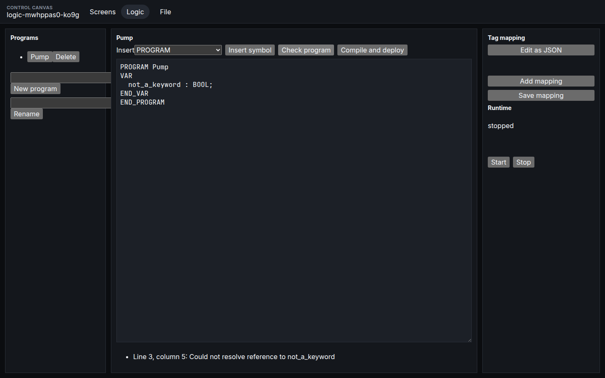
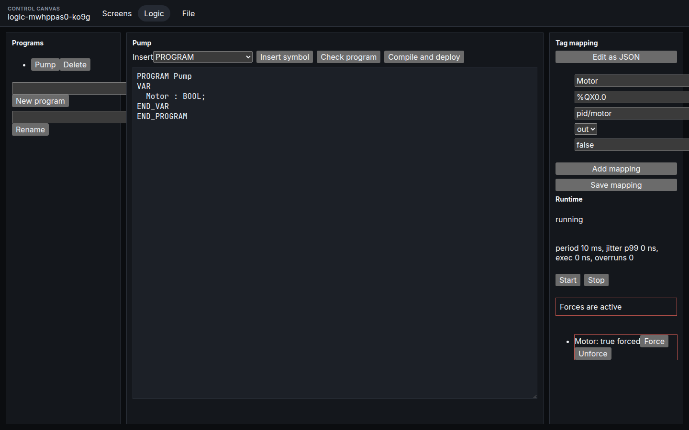

# Logic editor

:::caution PLC on Windows
This PLC is running on a Windows PC. Windows can't give the PLC truly dedicated CPU cores, memory, or interrupt-free timing, so scan timing isn't guaranteed and it does not behave like a real PLC. Use it for development, testing, training, and non-critical slow process control only — never for safety or fast motion. For real-time control, run the ERIC PLC on a Linux computer with a real-time kernel.
:::

**Logic** sits next to **Screens** in Control Canvas. It is where a Structured Text program is written, mapped to tags, and sent to the scan engine. It is not a safety controller.

## Write a program

1. Open a project.
2. Click **Logic**.
3. Type a program name and click **New program**.
4. Write the program in the text area. **Insert** adds a keyword, a standard timer, or `ERIC_PID`.
5. Click **Check program**. Problems list the line and column.

## Map tags

1. Click **Add mapping**.
2. Name the variable, give its address (such as `%QX1.0`), the tag path, and whether it is an input or an output.
3. For an output, set the safe value. That value is written while a new program is swapped in, and while the engine is stopped or faulted.
4. Click **Save mapping**. **Edit as JSON** shows the same file the scan engine reads.

## Deploy

1. Click **Compile and deploy**.
2. The gateway compiles the program. If it fails, the problems stay on the page and the previous program keeps running.
3. During a successful swap the outputs go to their safe values, then the new program starts.
4. **Start** and **Stop** run or hold the program. The status line shows running, stopped, or faulted, plus the period, jitter, execution time, and overruns.

## Watch and force

Watched variables refresh about four times a second. **Force** holds a value. A forced value is marked, and a warning says forces are active. **Unforce** clears it.

A force is sent to the scan engine. It does not override a stopped or faulted engine: those keep the safe outputs.
