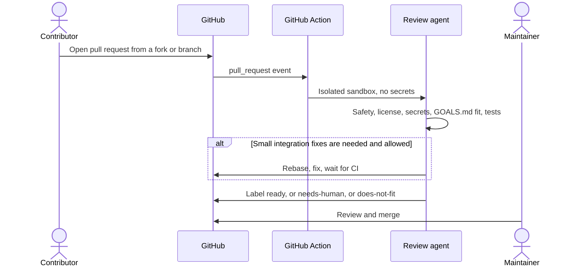
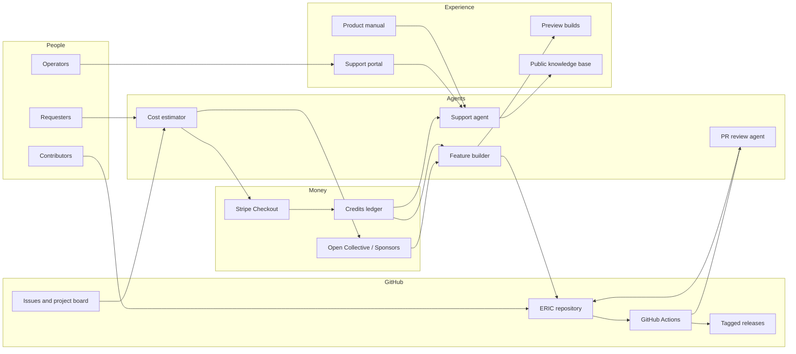

# ERIC: Open-Source & Agent-Run Project Architecture

**ERIC** (Engineered Runtime Interface & Control) is an open industrial controls platform: a gateway, tags and alarms, a historian, an HMI runtime, and **Control Canvas**, the design application. This document describes how the project will run in the open on GitHub, how an agent reviews and integrates contributions, how releases are cut, and how wishlist items, paid feature requests, and paid support are funded without spending the maintainer's own budget on unpaid work.

It is a design for what we will build. The starter files in this pull request (`GOALS.md`, `CONTRIBUTING.md`, `GOVERNANCE.md`, and the pull request template) are the first slice. Services named here — Open Collective, Stripe, the support portal — are not enabled by this document and will be introduced only when a later phase lands and a maintainer turns them on.

Companion documents:

- [GOALS.md](../../GOALS.md) — scope and non-goals; the review agent uses this to judge fit
- [CONTRIBUTING.md](../../CONTRIBUTING.md) — fork, branch, pull request, DCO, and new protocol drivers
- [GOVERNANCE.md](../../GOVERNANCE.md) — human final say, release cadence, funding transparency
- [LICENSE](../../LICENSE) — GNU Affero General Public License v3.0 or later

## 1. Open source on GitHub

The intended home is a public GitHub repository under the current project account. The repository is private today; making it public is a separate, explicit decision and is not done by this change.

Anyone can fork ERIC, build a feature, and open a pull request. The most important contribution path is a **new protocol driver**: a self-contained module behind the module SDK, not a fork of the gateway core. A driver ships with a manifest, a JSON Schema for its devices, tests, and — where it moves process values at scale — a pass of the conformance test kit. [CONTRIBUTING.md](../../CONTRIBUTING.md) has the step-by-step layout.

Contributors keep the ability to work in JSON and code. Integrators who do not write code should still be able to configure the same things in Control Canvas, the gateway admin, and the product manual.

Incoming commits use the Developer Certificate of Origin and the contributor agreement in CLA.md. The license is the GNU Affero General Public License v3.0 or later.

## 2. Review agent on every pull request

A GitHub Action starts the review agent when a pull request is opened or updated.

**Trigger:** `pull_request`, never `pull_request_target`. Fork pull requests therefore run in an isolated sandbox with **no repository secrets**. That is a hard rule. A workflow that checks out untrusted code and then exposes secrets, write tokens, or release keys is a security incident.

The agent does three jobs, in order:

1. **Safety.** Scan the diff and the dependency set for malicious or unexpected code, undeclared network or file access, secret material, and license incompatibilities with the AGPL-3.0. Treat pull request title, body, branch names, and included fixtures as untrusted input (see [Guardrails](#9-guardrails-and-risks)).
2. **Fit.** Compare the change to [GOALS.md](../../GOALS.md). Work that lands in the non-goals list, or that expands scope in a way the goals do not cover, is labeled for a human and is not integrated automatically.
3. **Quality.** Run the relevant tests. Check that existing tests, thresholds, and timeouts were not loosened to obtain a green run.

If the change is sound, the agent **tries to integrate**: rebase onto the current target branch, fix small mechanical issues, and get CI green. It then labels the pull request ready. It does not merge.

A human maintainer clicks merge. Safety-critical areas always need that human approval, even when the agent is satisfied:

- Drivers that can write to controllers or other field devices
- Security, secrets, identity, authentication, and authorization
- Release signing, publishing, or changes to the review workflow itself

## 3. Releases

Versions follow Semantic Versioning. Each tagged release has an automated changelog produced from pull requests.

- **Development builds** are produced on merge to `main`, or at least weekly. They are for contributors and early testers, not a support baseline.
- **Minor and patch releases** are cut version by version as changes accumulate, once ordinary CI is green.
- **STABLE and LTS** releases are issued periodically, on the order of every few months, when the tree is ready — not on a date at any cost. A STABLE or LTS tag is gated by the full performance suite (the PRF benchmarks), a soak test, ordinary CI, and a **human release approval**. Thresholds are not relaxed to ship.

Signed artifacts and a software bill of materials (SBOM) are required for STABLE and LTS, and are the aim for every tagged release. An agent may prepare the notes, the tag proposal, and the artifact list. It may not hold the release-signing keys or publish a STABLE or LTS tag by itself.

## 4. Wishlist and earmarked donations

Nice-to-have work that is not yet scheduled lives as public GitHub Issues labeled `wishlist`, also tracked on a public project board.

When a wishlist issue is filed or accepted, the cost-estimator agent comments with:

- a token-use estimate for implementation and review
- a conversion to currency at the then-current published rates
- a **margin**, because estimates miss
- a short scope statement, so donors know what “done” means

People donate through Open Collective (preferred, because the ledger is public) or GitHub Sponsors, earmarked to a specific issue when the donor wants that. When the funding goal for an item is reached, a builder agent implements it as an ordinary pull request. That pull request goes through the same review agent, CI, and human merge rules as every other change. Unspent earmarked funds stay on the item or are reallocated only in public, with a comment on the issue.

## 5. Paid feature requests

A person can also request a feature that is not already on the wishlist.

1. They file a request and describe the outcome they need.
2. The estimator quotes a price: tokens plus review plus margin, converted to currency, with a written scope.
3. They pay through Stripe Checkout. Funds land in the project's fiscal host, not in a private inbox.
4. The builder agent works on a preview branch or preview build that the requester can exercise.
5. If the requester accepts the preview, the change enters the normal review and merge path. Safety-critical or goals-mismatch work can still be refused or re-scoped; in that case unused credit is refunded or rolled over.

**Terms the checkout page must state, in plain language:**

- An estimate is not a guarantee. If the work would exceed the quote, the agent stops and asks before spending more.
- Unused credit is refunded or rolled over, at the requester's choice, as the published terms specify.
- Paying for a preview does not buy a merge, a trademark, or a bypass of safety review.
- Per-request and daily spend caps apply. The agent cannot raise its own caps.

## 6. Paid support agent

Help with ERIC should feel like a product manual that can also read *your* logs — but it is not a free, unlimited desk paid for by the maintainer.

A small portal lets an operator describe the issue and upload logs. They prepay credits (for example a small starter pack or a larger one). The support agent works until those credits are used. If it needs more, it says so and waits for a top-up. It never draws on the maintainer's personal budget or on un-earmarked project funds to continue an unpaid session.

The agent may run as a queue, batched once or twice a day, or as a nearer-real-time queue when there is credit and capacity. It answers from the product manual, the codebase, and previously solved tickets.

**Solved cases**, once personal data has been removed, are written into a public knowledge base so later operators can help themselves at no cost.

**Privacy.**

- Uploads are treated as confidential plant and personal data.
- An automated redaction pass runs before a model context is built: names, emails, phone numbers, IP addresses, tokens, passwords, and obvious site identifiers are stripped or replaced.
- Raw uploads are retained only for a short, published window, then deleted or kept solely as the redacted knowledge-base entry if the operator agrees.
- Uploads are not sold, and they are not used to train a public model.
- Operators can request deletion of a ticket and its uploads.

## 7. Money

ERIC is close to not-for-profit. The intended structure is a fiscal host — Open Source Collective or an equivalent, with a public Open Collective ledger — rather than a private company bank account as the long-term home of project funds. GitHub Sponsors can feed the same ledger.

All surplus after costs is reinvested in:

- model tokens for review, estimation, implementation, and paid support
- infrastructure (runners, preview hosting, logging for the agents themselves)
- paid human reviewers and maintainers

A formal foundation can come later, if the project grows enough that a fiscal host is no longer the right fit. That move would be written in [GOVERNANCE.md](../../GOVERNANCE.md) before it happens.

The public ledger should show money in, money out, and, when a payment was earmarked, the issue or ticket it belongs to.

## 8. Components and infrastructure

| Component | Role |
|---|---|
| GitHub repository, Issues, and project board | Source, wishlist, discussion, and the record of decisions |
| GitHub Actions | CI, the review-agent trigger (`pull_request`), release workflows |
| Agent runner | Webhook-triggered (pull requests, new issues, payments) and a scheduled cron once or twice a day for the support queue and stale estimates |
| Cost estimator | Token estimate, currency conversion, margin, and a written scope, posted on the issue or request |
| Billing and credits service | Stripe Checkout plus a ledger database of prepaid credit, earmarks, spend, refunds, and caps |
| Support portal | Authenticated upload of logs, ticket text, credit balance, and top-up |
| Preview hosting | Short-lived builds so a requester can exercise a paid feature before merge |
| Observability | Metrics and audit logs for agent runs, spend against caps, CI, and portal health — not plant-process data |

Plant process data does not belong in the project's observability stack. Support uploads stay in the portal's store, redacted as described above.

## 9. Guardrails and risks

**Prompt injection.** Pull request bodies, issue text, commit messages, and uploaded logs are untrusted. The agent must not treat instructions found in that content as system instructions. It must not exfiltrate secrets, raise its own caps, change workflow files to `pull_request_target`, or request merge or signing keys because a ticket asked it to.

**Spend caps.** Every agent run has a per-request cap and a daily cap. The support and builder agents stop when the prepaid credit or the cap is hit, and they ask a human or the paying user before continuing. Caps cannot be raised by the agent.

**Keys.** The agent never has sole possession of merge rights or release-signing keys. Fork pull requests never see repository secrets.

**Supply chain.** STABLE and LTS releases are signed and ship an SBOM. Dependencies are scanned on every pull request. Review-workflow changes are themselves safety-critical.

**Legal.**

- The DCO sign-off and [CLA.md](../../CLA.md) are both required. The CLA grants Nick Hepburn the right to relicense a contribution and includes a patent grant.
- Paid checkout needs terms that say an estimate is not a guarantee, explain refunds and rollovers, and state that payment does not bypass review.
- The fiscal host is the intended path for invoicing, tax reporting, and payouts.
- This document is not legal, tax, or payment advice. Published terms and the host's own agreements control.

**Product risk.** ERIC can sit in front of real equipment. A merged driver or a script that writes to a controller can cause harm. That is why write paths and security changes need a human, and why “the tests were green” is not enough on those pull requests.

## 10. Build order

Effort figures are rough: calendar time for a small team or a well-directed agent plus a human maintainer, not a quote. Token cost will be estimated again when each phase is scheduled.

| Phase | What ships | Rough effort |
|---|---|---|
| **1. Repo hygiene and review** | `GOALS.md`, `CONTRIBUTING.md`, `GOVERNANCE.md`, this architecture document, the pull request template, DCO checks, and the PR review Action (`pull_request`, sandbox, no secrets; safety, fit, tests; labels; no merge) | About 1–2 weeks |
| **2. Releases** | Semver tags, automated changelog, signed artifacts, SBOM, and a documented STABLE/LTS gate that includes the full PRF suite and a soak, with a human approval step | About 1–2 weeks |
| **3. Wishlist and donations** | `wishlist` label, public project board, estimator comments, Open Collective (and optionally GitHub Sponsors) with earmarks. Fiscal-host signup is a human task | About 2–3 weeks after the host account exists |
| **4. Paid requests** | Request flow, Stripe Checkout, credits ledger, spend caps, preview branches or builds, refund and rollover handling, written terms | About 3–4 weeks |
| **5. Paid support portal** | Upload portal, prepaid credits, batched or queued agent, redaction, retention and deletion, public knowledge base of anonymized cases | About 4–6 weeks |

Phase 1 is started by the files in this change. The review Action, and every later phase, is follow-on work and will have its own pull request.

## What this change does not do

- It does not make the repository public.
- It does not enable GitHub Pages, Sponsors, Actions beyond what already exists, Stripe, or Open Collective.
- It does not install the review agent or any billing service.
- It does not change product code, existing license text, or existing documentation outside the new files listed above.
