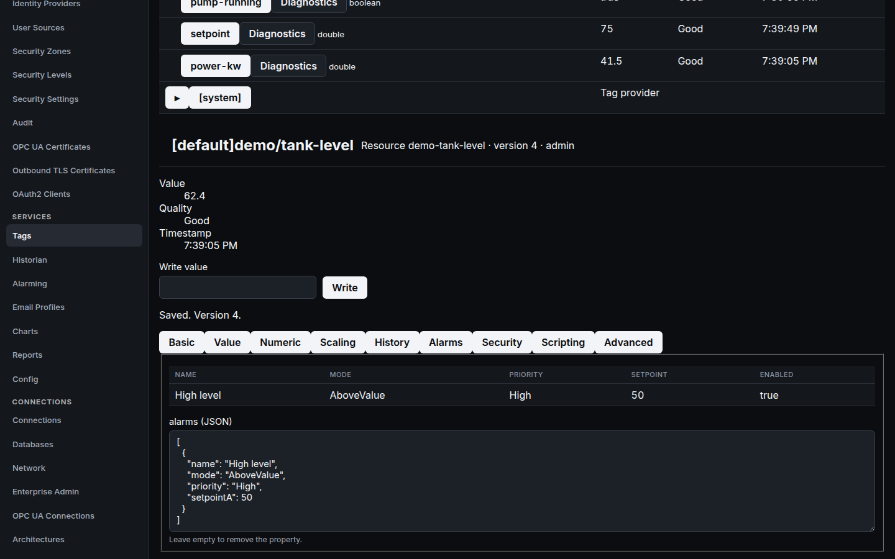
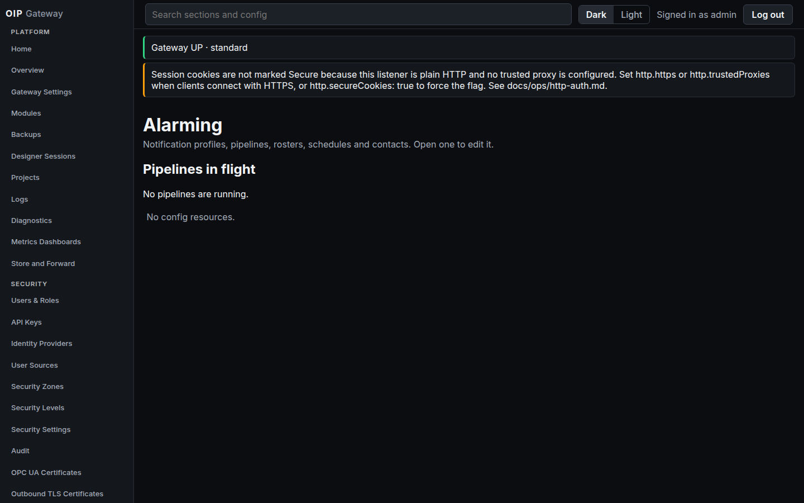

# Alarming

## Add an alarm to a tag

1. Open **Tags**, select the tag and open the **Alarms** tab.
2. In the **alarms (JSON)** box, enter a list of alarm definitions. Example:

```json
[{ "name": "High level", "mode": "AboveValue", "priority": "High", "setpointA": 50 }]
```

3. Choose **Save**. The tab then shows a table of the tag's alarms (name, mode, priority, setpoint, enabled).



Modes: above value, below value, equality, bit state, out of range and outside values. Priorities: Diagnostic, Low, Medium, High, Critical. Setpoints can be a number or a binding to a tag, expression or parameter. Leave the box empty to remove the alarms.

## Notification pipeline

The **Alarming** page lists rosters, pipelines, schedules, and contacts, and shows pipelines that are already running.

1. Choose **New roster**. Name it with lowercase letters, digits, and hyphens. Type the user names, separated by commas. Save.
2. Choose **New pipeline**. Set the roster name from step 1. An email profile is optional. Write the message. A delay in seconds waits before the pipeline finishes. Leave the delay blank to notify and finish. Tick **Stop when acknowledged** if an operator ack should end the pipeline. Save.
3. A schedule is weekday hours, such as `08:00-17:00`. A contact is an email and a phone. SMS and voice are not sent in this build. The phone field is stored. It does not place a call.
4. Pipelines are a form, not a drawing. A graphical pipeline editor is on the wishlist.

## Power user

A pipeline spec is a list of blocks. The form writes a notification block whose `roster` is the roster name, then an optional wait. Edit as JSON on the same page when you need a field the form does not show. Unknown fields are kept when you round-trip through the form.



Operators see and acknowledge active alarms in a runtime session: [Alarms and charts](../runtime/alarms-charts.md). Alarm events can be journaled to a database: [Databases](databases.md).
