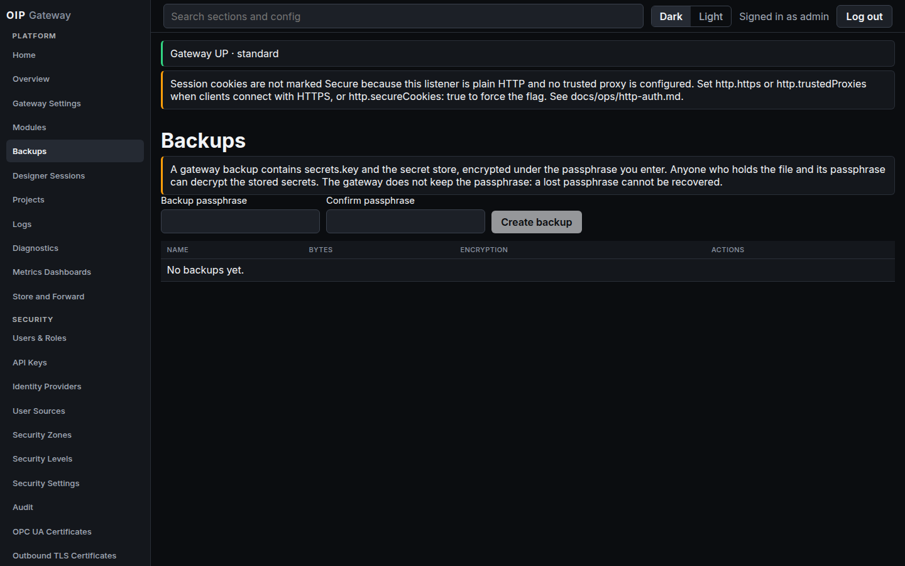

# Backups

**Backups** (Platform group) creates, downloads and restores gateway backups.

**Warning:** a backup holds the secrets key and secret store. It is always encrypted under a passphrase you choose. The gateway does not keep the passphrase: a lost passphrase means the backup cannot be restored.

## Create a backup

1. Enter a **Backup passphrase** and repeat it under **Confirm passphrase**.
2. Choose **Create backup**. It appears in the list with **Download** and **Restore** buttons.

## Restore

Choose **Restore <name>**, enter the **Restore passphrase** and confirm. Backups need the administrator role. For command-line backups, restore on first boot in containers, and what the file contains, see [docs/ops.md](../../ops.md#backups) and [docs/ops/container-recipes.md](../../ops/container-recipes.md).
