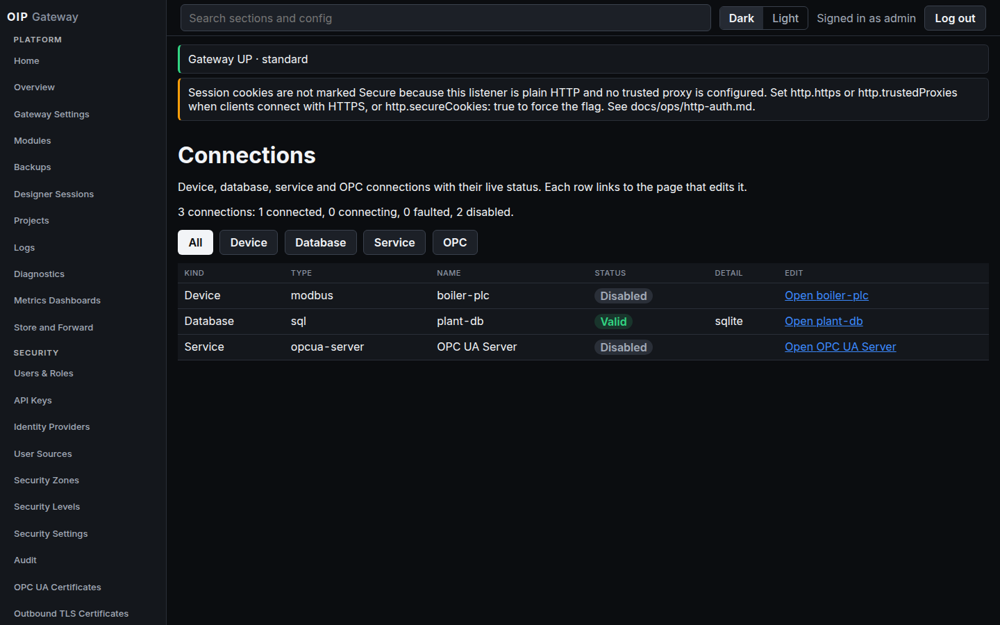

# Connections and devices

**Connections** (Connections group) lists every device, database, service and OPC connection with its live status: connected, connecting, faulted or disabled. Use the **All / Device / Database / Service / OPC** buttons to filter. Each row's last column links to the page that edits it.



## Add a driver connection

There is no "new device" form in the admin pages. A device is a config resource of the driver's module, created with the config API (or by editing the config files). The installed drivers appear as `ModuleConfig` entries on the **Config** page: BACnet/IP, DNP3, Logix, Modbus, MQTT, OPC UA client, S7, simulator and UDP/TCP.

Example, a Modbus TCP device. Create an API key on **API Keys** and send it as a bearer token:

```
curl -X PUT -H "Authorization: Bearer $OIP_TOKEN" -H "Content-Type: application/json" \
  http://127.0.0.1:8090/api/v1/config/org.oip.driver-modbus/gateway/Device/boiler-plc \
  -d '{"apiVersion":"oip/v1","kind":"Device",
       "metadata":{"name":"boiler-plc","module":"org.oip.driver-modbus","version":0},
       "spec":{"name":"boiler-plc","host":"192.168.10.20","port":502,"mode":"TCP","unitId":1}}'
```

The device then shows on **Connections**. Open its row to edit the settings in the schema editor, or use the **Config** page. Set `"enabled": false` to keep it configured but idle. Each driver's `spec` fields are listed by its schema in that editor.

To create tags from a device, see [Tags](tags.md#create-tags-from-a-device).
