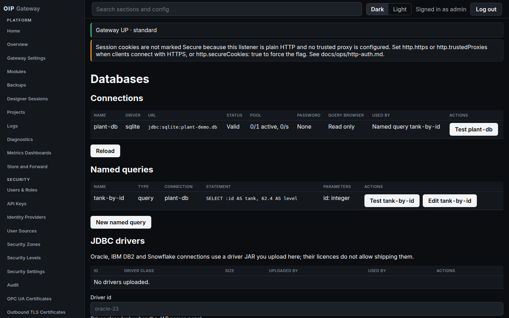

# Databases

The **Databases** page (Connections group) shows database connections and named queries, uploads JDBC drivers, picks the alarm journal storage, and has a query browser.



## Add a PostgreSQL connection

Connections are created with the API; the password is stored as a secret and never shown on the page.

```
curl -X POST -H "Authorization: Bearer $OIP_TOKEN" -H "Content-Type: application/json" \
  http://127.0.0.1:8090/api/v1/db/connections \
  -d '{"name":"plant-db","driver":"postgres",
       "url":"jdbc:postgresql://db.example:5432/plant",
       "username":"oip","password":"..."}'
```

Known `driver` values: postgres, sqlite, sqlserver, azuresql, mariadb, mysql, oracle, db2, snowflake and custom. If a driver's JAR is not bundled, upload it under **JDBC drivers** (driver id, optional driver class, JAR). Choose **Reload** to refresh the table, then **Test plant-db** to check the connection.

## Named queries

A named query is a parameterised statement tied to a connection and used from bindings and scripts. Choose **New named query**, or POST to `/api/v1/db/queries`:

```json
{ "name": "tank-by-id", "connection": "plant-db", "queryType": "query",
  "sql": "SELECT * FROM tank WHERE id = :id",
  "parameters": [{ "name": "id", "dataType": "integer" }] }
```

Use **Test** on a query row, fill in the parameters and **Run** to see the result table.

## Query browser

Pick a **Connection**, type a **SQL statement**, set the **Row limit** and choose **Run statement**. Statements that change data are refused on connections that are read only.
