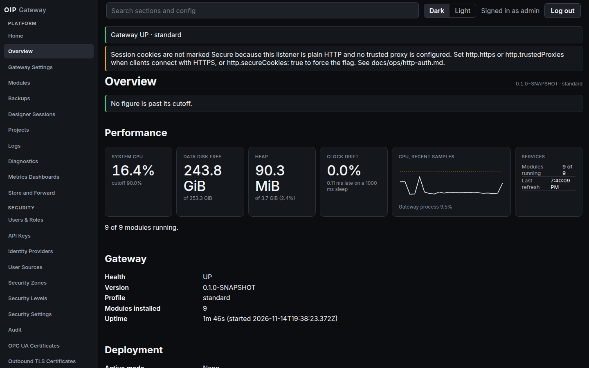
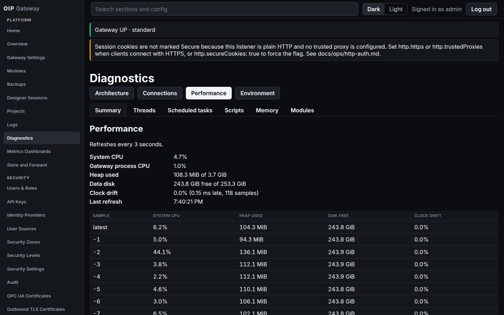
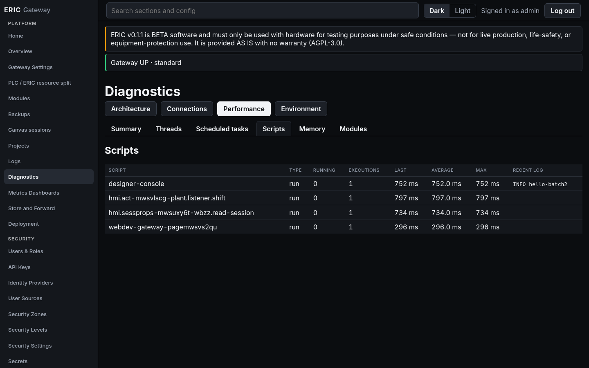
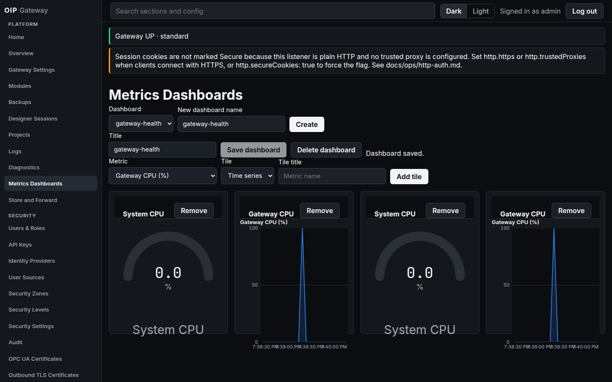
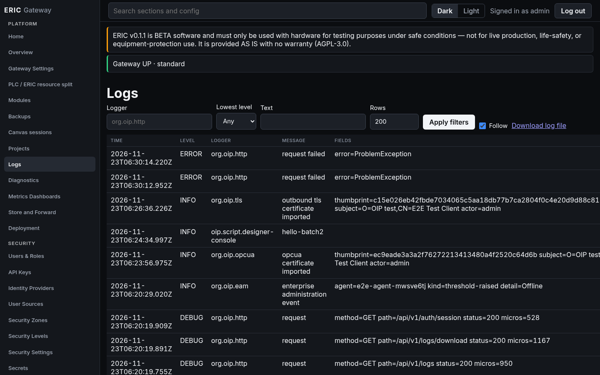

# Diagnostics, logs and metrics

Health and performance numbers are on Overview, Diagnostics, Metrics Dashboards and Logs.

## Overview

**Overview** (Platform group) shows health, version, profile, installed modules, uptime, the deployment mode and a live performance block: CPU, heap, data disk free and clock drift. **Deployment** shows the active deployment mode and has a **Deployment mode** box with **Switch mode** and **Clear mode**. A mode applies per-environment overrides, for example a different database URL in dev, test and prod: see [docs/ops/deployment-modes.md](../../ops/deployment-modes.md). A warning appears at the top when a threshold is crossed, for example a nearly full data disk.

## Diagnostics

**Diagnostics** has the tabs Architecture, Connections, Performance and Environment. Performance has sub-tabs Performance, Threads, Scheduled tasks, Memory and Modules, and refreshes every 3 seconds. A table keeps the latest few samples of CPU, heap, disk and clock drift.

The **Scripts** tab lists the running scripts with their type, whether they are running, execution count, last, average and maximum run time, and recent log output.

**Store and Forward** shows the history buffer, throughput and quarantine.

## Metrics dashboards

**Metrics Dashboards** (Platform group) holds dashboards you build from gateway metrics. Name a dashboard under **New dashboard name** and choose **Create**. Then pick a **Metric**, a tile type (**Gauge** or **Time series**), an optional **Tile title** and choose **Add tile**. **Remove** drops a tile; **Save dashboard** stores the layout, and **Delete dashboard** removes it. Tiles refresh on their own.

## Logs

**Logs** lists gateway log records. Use **Log filters** (logger, minimum level, search text, row limit) and **Apply filters**; **Follow** refreshes the list as new records arrive. **Logger levels** lists the logger levels; use **Change logger level** to set a logger to TRACE, DEBUG, INFO, WARN or ERROR. A level change is written to the audit log.

## Log files on disk

The gateway also writes plain-text rolling log files to `<dataDir>/logs/` (`gateway.log` and older `gateway.log.1`, `.2`, and so on), next to the structured `gateway.jsonl`. Size and count are set under `logging:` in `gateway.yaml` (`files`, `maxFileKb`, `maxFiles`); changes apply at the next start. See [docs/ops.md](../../ops.md#log-files).
