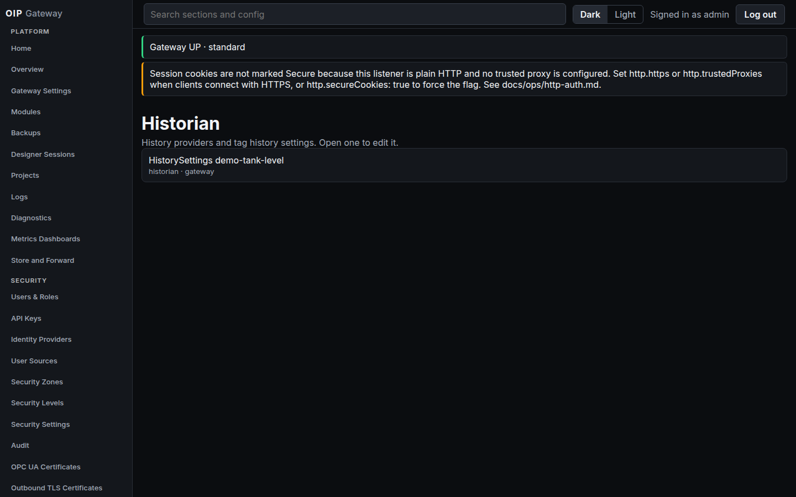

# Historian

The **Historian** page (Services group) lists history providers and per-tag history settings. This gateway does not collect history from a tag's own History tab (that tab says so). Instead, history for a tag is a `HistorySettings` config resource in the `historian` module.



## Enable history on a tag

Create a `HistorySettings` resource that names the tag:

```
curl -X PUT -H "Authorization: Bearer $OIP_TOKEN" -H "Content-Type: application/json" \
  http://127.0.0.1:8090/api/v1/config/historian/gateway/HistorySettings/demo-tank-level \
  -d '{"apiVersion":"oip/v1","kind":"HistorySettings",
       "metadata":{"name":"demo-tank-level","module":"historian","version":0},
       "spec":{"tagPath":"[default]demo/tank-level","sampleMode":"periodic",
               "sampleRateMillis":5000,"deadband":{"mode":"absolute","value":0.5},
               "maxTimeBetweenSamplesMillis":60000}}'
```

- `sampleMode`: `onChange` (default) or `periodic`; `sampleRateMillis` applies to periodic.
- `deadband`: `off`, `absolute` or `percent`, with a `value`.
- `maxTimeBetweenSamplesMillis` stores a sample at least that often (0 disables).
- `storageProvider`: `local` (the built-in historian, default) or the name of a `HistoryProvider` resource.

The resource appears on the Historian page. Open it to edit in the schema editor; delete it to stop collection. Collection resumes after a restart. Chart the data in a view with the power chart's historical mode ([Alarms and charts](../runtime/alarms-charts.md)).
