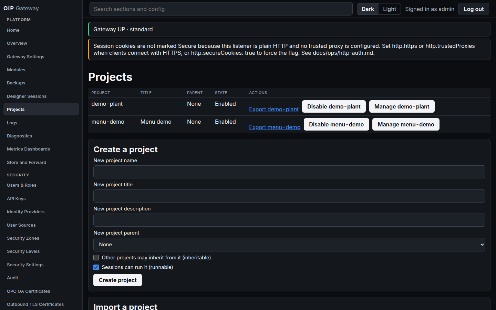

# Projects

A project is a set of views, pages, styles and scripts that a runtime session runs. The **Projects** page (Platform group) creates, imports and exports them.

## Create a project

Under **Create a project**, enter a name, title and description. Optionally pick a **parent** project to inherit from (the parent must be marked inheritable), and tick **Sessions can run it (runnable)**. Choose **Create project**. Then open it in the Control Canvas: `/studio/?project=<name>`.

## Export and import

Each project row has an **Export <name>** link that downloads a zip. Under **Import a project**, choose the archive, the project to import into, and a conflict policy: keep the existing resource (skip) or replace it with the archive copy (overwrite). Choose **Import**.

## Manage

**Manage <name>** on a row edits the project's title, description and parent, and shows how many resources it holds and the inheritance chain. Project permissions and resource locks are in the Control Canvas ([workspace](../studio/workspace.md)).

## Public HMI

Public HMI is off when you create a project. Leave it off unless the HMI is a bench you are willing to leave unsigned-in.

1. Open the project settings.
2. Tick **Public HMI**. Save.
3. Opening `/hmi/<project>/` with no sign-in then creates a session that can read and write tags for that HMI.
4. `/admin` still requires an administrator. A project you did not tick stays signed-in.

The Brownsville example turns this on for itself. Importing it does not turn it on for any other project.

## Example projects

**Import example** on this page lists examples the gateway can see. Set `OIP_EXAMPLES` to the `examples` directory, or start the gateway from a checkout that contains `examples/`. The same import is File → New from example in Control Canvas. See [Brownsville](../examples/brownsville.md).

## Power user

`PATCH /api/v1/projects/{name}` with `If-Match` set to the project version updates settings. `publicHmi` true enables the anonymous HMI. `GET /api/v1/examples` lists examples. `POST /api/v1/examples/{id}/install?replace=true` imports one.
