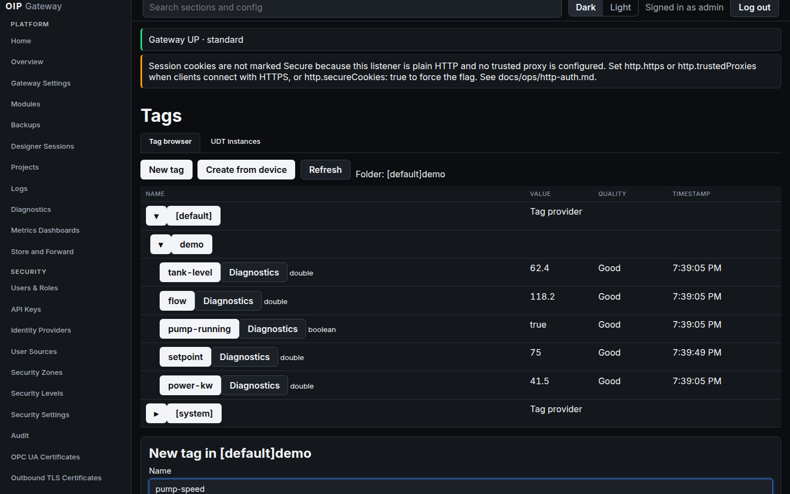
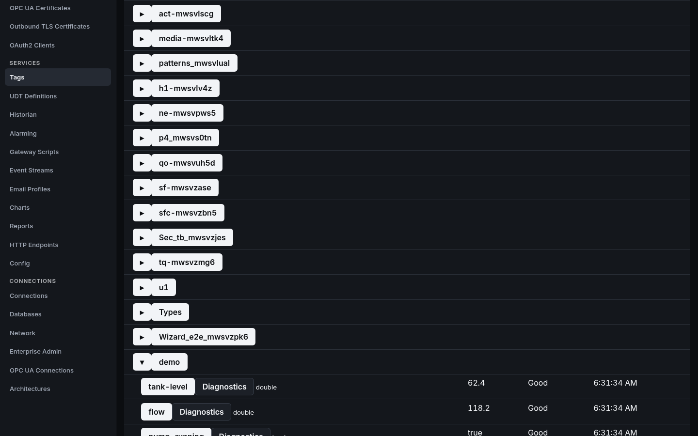

# Tags

The **Tags** page (Services group) is the tag browser and editor. Tags live under a provider such as `[default]`; folders group them.

## Create a memory tag

1. Select a folder (for example `[default]`) and choose **New tag**.
2. Enter a **Name**. `Folder/Tag` creates the tag inside a folder path.
3. Pick the **Tag type** and **Data type**. Types offered: memory, expression, derived, reference, opc and folder. A memory tag holds a value you write; give it an **Initial value**.
4. Choose **Create tag**.

For a **folder**, pick the type "folder". An expression tag takes an expression; derived and reference tags take a source path; an OPC tag takes a server and item path.

## Edit a tag

Select a tag to see its value, quality and timestamp. **Write value** writes a value (needs write permission). The tabs are Basic, Value, Numeric, Scaling, History, Alarms, Security, Scripting and Advanced. Change fields, then **Save** or **Discard changes**. **Move** renames or moves the tag; **Delete tag** removes it.

## Create tags from a device

Select a folder and choose **Create from device**. Pick the **Device**, browse its nodes, tick the ones you want, set the **Data type for new tags**, and choose **Create N tags**.

## UDTs

A UDT (user-defined type) is a reusable structure, such as a lift station with two pumps. Define the type once on the **UDT Definitions** page (Services group), then create instances from the Tags page.

### Create a UDT definition

1. Open **UDT Definitions** and choose **New UDT definition**.
2. Fill in **Type path** (for example `LiftStation/Duplex`). **Resource name** is filled in from it. Pick **Inherits from** if this type extends another one.
3. Under **Parameters**, choose **Add parameter** for each value an instance fills in, such as `Device` or `Site`. Give each a name, data type and optional default. Use a parameter in a member as `{Device}`.
4. Under **Members**, choose **Add member** for each value. Each member has a **Member name**, **Kind**, **Data type** and **Description**. The kinds are:
   - **Device address**: read straight from a device. Pick the **Device** (a configured Modbus or OPC UA connection, or a parameter such as `{Device}`), the **Address** (for Modbus `HR215`, `HR201.10` for a bit, `C1` for a coil; for OPC UA a node id), **Poll rate (ms)** and **Read only**. No separate field tags are needed.
   - **Memory**: holds a value you write, with an **Initial value**.
   - **Expression**: computed from an **Expression**.
   - **Reference**: follows another tag (**Source tag path**).
   - **Derived (scaled from another tag)**: a **Source tag path** with a **Read expression** and **Write expression**.
   - **Nested UDT**: an instance of another UDT type (**Nested UDT type**), such as a pump inside a lift station.
5. For numeric members, set **Scaling** (raw and scaled ranges, **Clamp to the scaled range**), **Engineering units**, the engineering range, and a **Value deadband**.
6. Under **Alarms**, choose **Add alarm**: **Alarm name**, **Condition** (above, below, equal, not equal, between, outside, or any change), **Priority**, setpoints, deadband and on-delay.
7. Under **History**, tick **Record history for this member** and pick the **History provider** (the built-in historian or a provider from the Historian page, such as a PostgreSQL provider), the **Sample mode**, the sample rate, the **History deadband** and the maximum time between samples.
8. Choose **Create definition**.

Choose **Edit <type>** to change a definition and **Save definition**; every instance picks up the change, including new device addresses. **Delete <type>** removes a definition that no instance uses. Use the arrows to reorder members.

### Create UDT instances

The **UDT instances** link at the top of the Tags page opens the wizard: pick a UDT definition, fill in the instance parameters, review the instance plan and preview, then **Create UDT instances**.

**Export and import** moves tag configuration as JSON. It is optional; everything above can be done in the forms.

## History and alarms

History for a UDT member is set in the UDT definition (above). For a standalone tag, use **Record a tag** on the [Historian](historian.md) page. Alarms are set on the tag's Alarms tab: see [Alarming](alarming.md).
