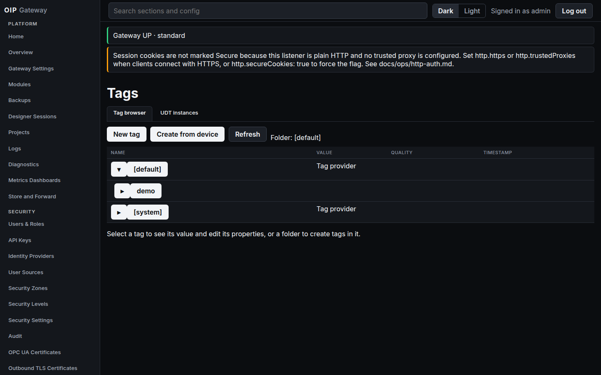

# Tags

The **Tags** page (Services group) is the tag browser and editor. Tags live under a provider such as `[default]`; folders group them.

## Create a memory tag

1. Select a folder (for example `[default]`) and choose **New tag**.
2. Enter a **Name**. `Folder/Tag` creates the tag inside a folder path.
3. Pick the **Tag type** and **Data type**. Types offered: memory, expression, derived, reference, opc and folder. A memory tag holds a value you write; give it an **Initial value**.
4. Choose **Create tag**.

For a **folder**, pick the type "folder". An expression tag takes an expression; derived and reference tags take a source path; an OPC tag takes a server and item path.

## Edit a tag

Select a tag to see its value, quality and timestamp. **Write value** writes a value (needs write permission). The tabs are Basic, Value, Numeric, Scaling, History, Alarms, Security, Scripting and Advanced. Change fields, then **Save** or **Discard changes**. **Move** renames or moves the tag; **Delete tag** removes it.

## Create tags from a device

Select a folder and choose **Create from device**. Pick the **Device**, browse its nodes, tick the ones you want, set the **Data type for new tags**, and choose **Create N tags**.

## UDTs

The **UDT instances** link at the top of the page opens the wizard: pick a UDT definition, fill in the instance parameters, review the instance plan and preview, then **Create UDT instances**. **Export and import** moves tag configuration as JSON.

## History and alarms

History is not a per-tag property here: see [Historian](historian.md). Alarms are set on the tag's Alarms tab: see [Alarming](alarming.md).
