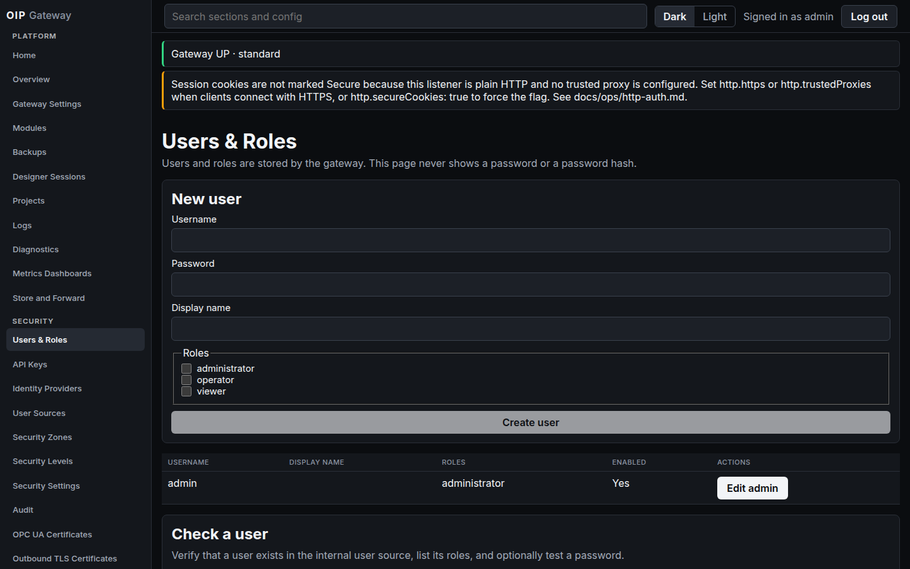

# Users and roles

**Users & Roles** (Security group) manages the accounts used to sign in to the admin pages, the Control Canvas and runtime sessions.

## Create a user

1. Fill in **Username**, **Password** and optionally **Display name**.
2. Tick the roles: **administrator**, **operator** or **viewer**.
3. Choose **Create user**.

To change a user, choose **Edit <name>**: change roles or use **New password** and **Reset password**.

## Roles

**Roles** lists the roles with **Edit role** and **Delete role**. **New role** takes a role name, a description and a set of permissions. Roles are also what a component's security setting names in the Control Canvas ([Touchscreens and security](../runtime/touch-security.md)).

## Check a user

Under **Check a user**, enter a username (and optionally a password to test) and choose **Check user**. The result appears under **Check result**; use it to diagnose a login problem.

Other Security pages: API Keys (tokens for scripts and the API), Identity Providers (single sign-on), User Sources (directory and database accounts), Security Zones, Security Levels, Security Settings (password policy, retention) and Audit.
