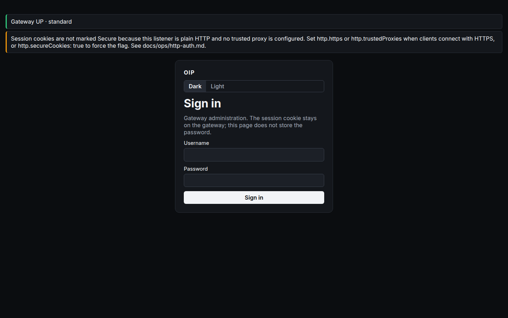
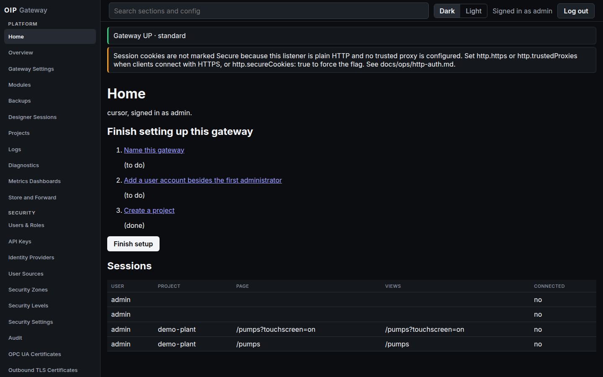

# Getting started

**ERIC v0.1.0 is BETA software and must only be used with hardware for testing purposes under safe conditions — not for live production, life-safety, or equipment-protection use. It is provided AS IS with no warranty (AGPL-3.0).** The same warning is on the [safety page](safety.md), on the installer license screen, and on the admin and Control Canvas banners.

Testers who want one path from install to a screen should follow [Getting started for testers](getting-started-testers.md).

## Install and run

Pick one; each has its own page, so this manual does not repeat them.

- Windows installers: [docs/install/windows.md](../install/windows.md).
- Containers: [docs/ops/container-recipes.md](../ops/container-recipes.md).
- Command line: `oipctl start --data-dir <dir>` starts the gateway and prints its URL; see [docs/ops.md](../ops.md#start-stop-and-restart).

- Kubernetes: the Helm chart in `packaging/helm/oip-gateway` runs one gateway with its data directory on a persistent volume; the admin password comes from an existing Secret. See [its README](../../packaging/helm/oip-gateway/README.md).

The default address is `http://127.0.0.1:8090/admin` (the container recipes publish port 8088).

## Sign in

On first start `OIP_ADMIN_PASSWORD` creates the user `admin` when no users exist. Open `/admin`, enter the username and password, and choose **Sign in**.

The **Home** page has a setup checklist, **Launch** links, and per project an **Open <name> session** link and an **Edit <name> in Control Canvas** link.

## Change the admin password

1. Open **Users & Roles** (Security group).
2. Choose **Edit admin**.
3. Type the new password under **New password** and choose **Reset password**.

The password must satisfy the password policy (default: at least 8 characters, three of lowercase, uppercase, digit and special, and not containing the username). If you lose the administrator password, stop the gateway and run `oipctl reset-admin`; see [docs/ops.md](../ops.md#lost-administrator-password).

A banner on every admin page warns when session cookies are not marked Secure (plain HTTP). Set up HTTPS as described in [docs/ops/https.md](../ops/https.md).
