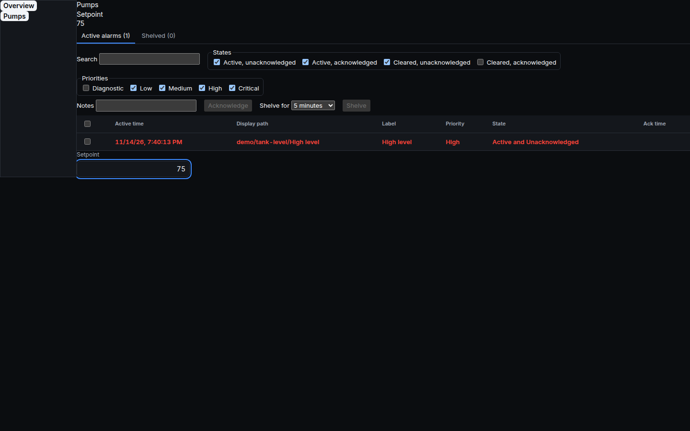
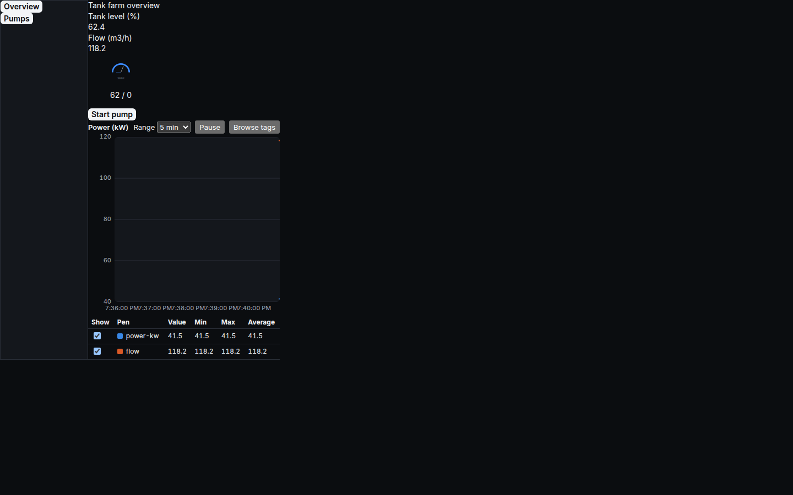

# Alarms and charts

## Alarm status table

The alarm status table lists alarms from the tags' alarm definitions ([Alarming](../gateway/alarming.md)). Tabs show Active alarms and Shelved alarms.

- **Search** and the **States** and **Priorities** boxes filter the list.
- Tick rows, optionally type **Notes**, and choose **Acknowledge**.
- Choose a **Shelve for** time and **Shelve** to silence tick-marked alarms for a while.

An alarm row shows its active time, display path, label, priority and state, for example "Active and Unacknowledged".

## Power chart

The power chart plots its **Pens** (tag paths). Realtime mode refreshes continuously; **Range** sets how much history the window shows, **Pause** freezes it, and **Browse tags** picks pens. A table under the chart lists each pen's value, minimum, maximum and average, with **Show** boxes. In historical mode the chart reads stored history ([Historian](../gateway/historian.md)).

