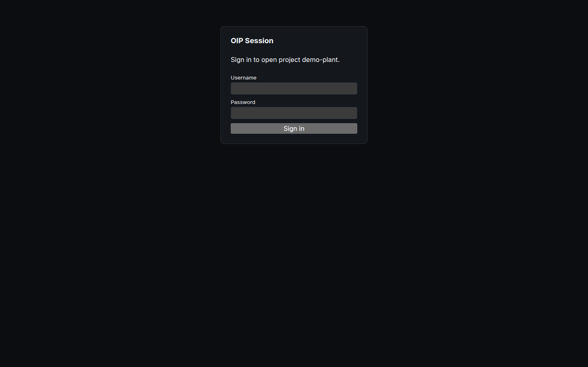
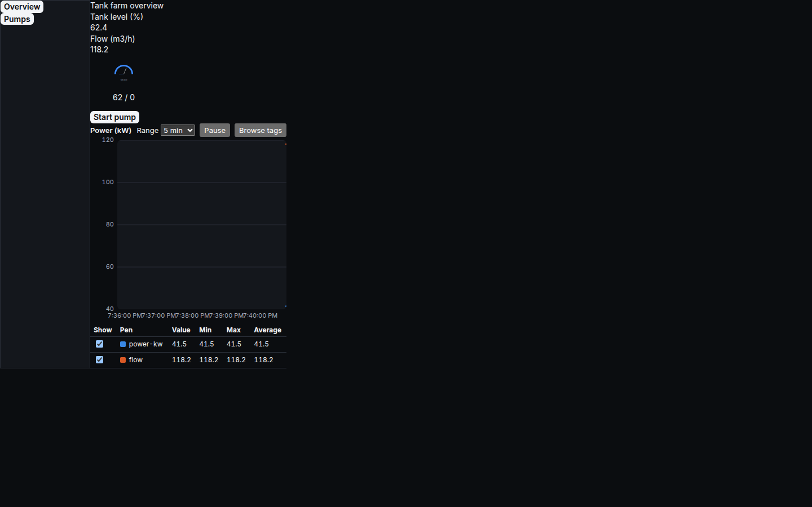

# Sessions, navigation and live values

## Open a session

Browse to `/hmi/<project>/`, for example `/hmi/demo-plant/`. If you are not signed in, the session asks for your gateway username and password.

The Home page's **Open <project> session** link opens the same address.

## Navigation

Each page has its own URL (`/hmi/demo-plant/pumps`), so the browser's back button and bookmarks work. Move between pages with the project's menu or buttons whose action is Navigation. In the demo, the Menu dock on the left holds **Overview** and **Pumps**.

## Live values

Labels, gauges and charts bound to tags update as the tags change. The session keeps one connection to the gateway; a change saved in the Control Canvas reaches open sessions without a reload.

The values on the page are the demo's memory tags: level 62.4, flow 118.2, with the gauge and power chart following them.
