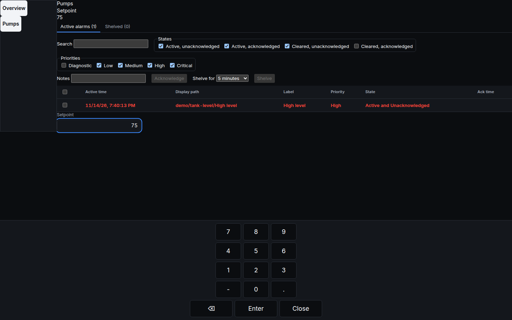

# Touchscreens and security

## Touchscreens

Touchscreen mode shows an on-screen keyboard when an input gets focus. Numeric inputs get a number pad (digits, minus, point, backspace, **Enter**, **Close**); other inputs get a letter keyboard. Turn it on for one session by adding `?touchscreen=on` to the address (`/hmi/demo-plant/pumps?touchscreen=on`), from a script with `session.custom.touchscreen`, or for a whole project with the project's `touchscreenMode` setting.

Without touchscreen mode a session uses the device's own keyboard.

## Signing in

A session signs in with the same gateway accounts as the admin pages. Sign out with a Logout action if the project has one, or by closing the session.

## Who sees what

- A component can be limited to roles or security levels in the Control Canvas: select it and fill in **Security** ("Roles that receive this component", "Security levels"). Leaving both empty shows it to anyone.
- Tag read and write access follows the tag's security settings and the user's roles; a protected value is hidden and a write to a read-only tag is refused.
- A project can be restricted so only some users can open it; an unauthorised user sees a refusal.

Manage accounts and roles in [Users and roles](../gateway/users.md).
