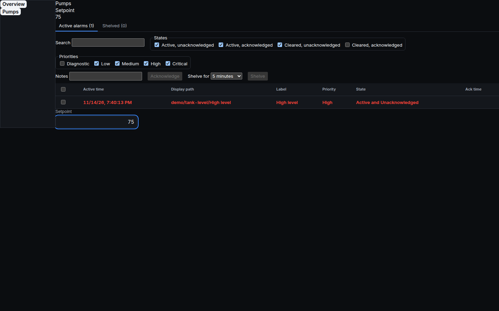

# Writing a value

An operator can change a tag in two ways, depending on how the view was built.

## Setpoint entry

A **numeric entry field** bound bidirectionally to a tag writes the tag when you commit. Click the field, type the number, and press **Enter** (or leave the field). If the number is not valid or is outside the field's minimum and maximum, nothing is written, the field stays marked invalid and says why. **Escape** cancels the edit.

## Buttons

A button whose click action is a Tag write sets its tag to the configured value ("Start pump" sets `pump-running` to true).

Writes happen as the signed-in user. A tag or component protected by a role or security level refuses a user who lacks it ([Touchscreens and security](touch-security.md)).
