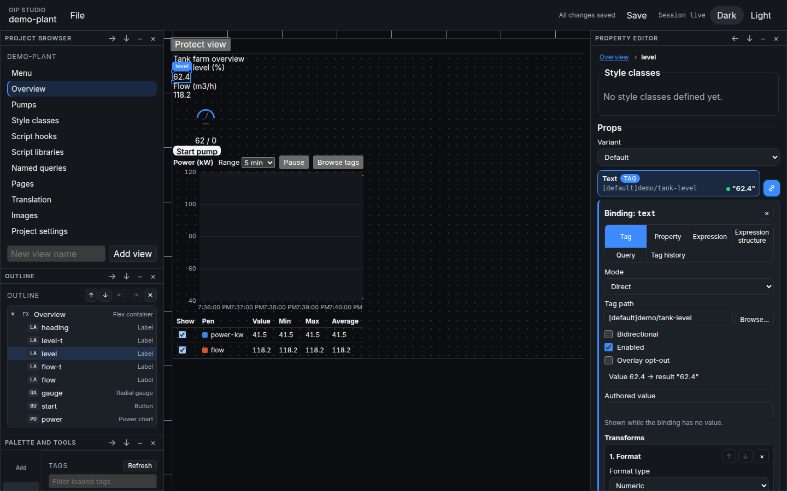

# Bind a property to a tag

A binding makes a property follow a live value.

## With the binding editor

1. Select the component (for example the label `level`).
2. In the Property editor, choose the link button beside the property (the button named "Bind <property>").
3. In the binding box pick the kind: **Tag**, Property, Expression, Expression structure, Query or Tag history.
4. For a Tag binding, enter the **Tag path** (for example `[default]demo/tank-level`) or choose **Browse...**. Pick the **Mode** (Direct is the default).
5. Tick **Bidirectional** when the property should also write back to the tag (used for input components such as the numeric entry field). **Enabled** switches the binding on or off.

The box shows the live value and the result after transforms. Add **Transforms** below, for example a Format transform (numeric format with decimals).

## By dragging

Open the **Tags** tab, then drag a tag onto the canvas to create a component for it, or onto a selected component to bind its default property.

## Other binding kinds

Expression bindings compute a value from tags and other properties; Query bindings run a named query ([Databases](../gateway/databases.md)); Tag history bindings read the historian ([Historian](../gateway/historian.md)).
