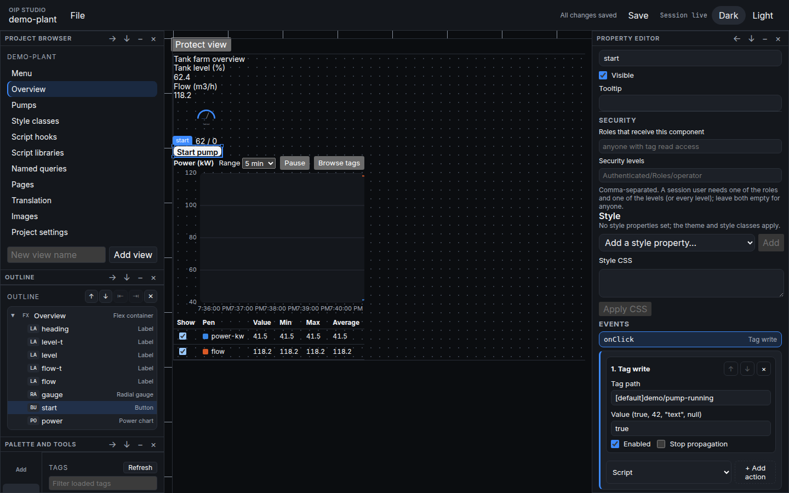
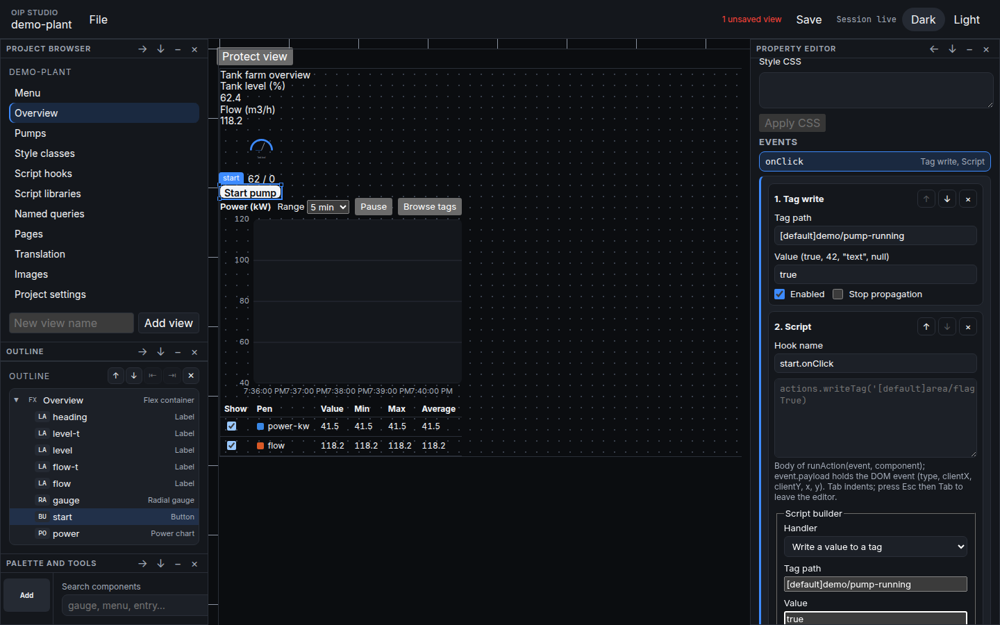
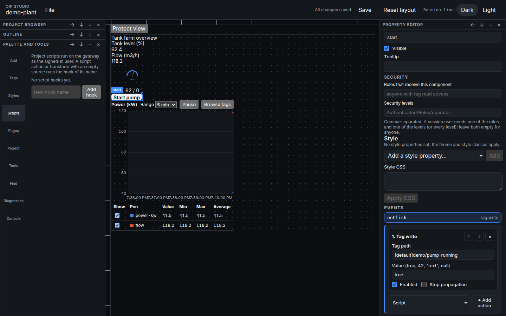

# Events and scripts

## Event actions (no code)

Components with events (a button's `onClick`, for example) list them under **Events** in the Property editor. Choose the event, then pick an action type and **+ Add action**:

| Action | What it does |
| --- | --- |
| Tag write | Writes a value to a tag path (the value may be `true`, a number, text or null). |
| Navigation | Goes to a page URL, or opens another target. |
| Popup | Opens or closes a popup showing a view. |
| Message | Sends a message to the page or session. |
| Call method | Calls a component method. |
| Logout | Signs the user out of the session. |
| Script | Runs a script (below). |

These forms need no code, so a button that starts a pump is a Tag write with path `[default]demo/pump-running` and value `true`. Each action can be switched off with **Enabled**, and **Stop propagation** is available. Actions run in order; use the arrows to reorder them.

## Scripts

Scripts are Python. The **Script builder** inside the Script action writes the common ones for you. Choose the **Script** action, enter a **Hook name**, and write the **Script source**. The script runs on the gateway as the signed-in user, receives the DOM event as `event.payload`, and can call `actions.writeTag(path, value)`. Scripts never run inside Control Canvas, only in sessions.

### Script builder

Below the **Script source** box, the **Script builder** has a **Handler** list: Navigate to page, Navigate to view, Write a value to a tag, and Run a named query. Fill in the target (a page URL, view path, tag path or query name), a **Value** (`42`, `true`, text, or `=event.payload.x` to use the event), or **parameters** (`name = value`, one per line), then choose **Add to script**. The generated lines are appended to the source, where you can edit them.

The **Scripts** tab manages project script hooks, reusable by name: **Add hook**, then fill in its source.

Which `system.*` functions a script can call depends on where it runs: see [docs/scripting-overview.md](../../scripting-overview.md). The **Console** tab runs scripts on the gateway as you.
