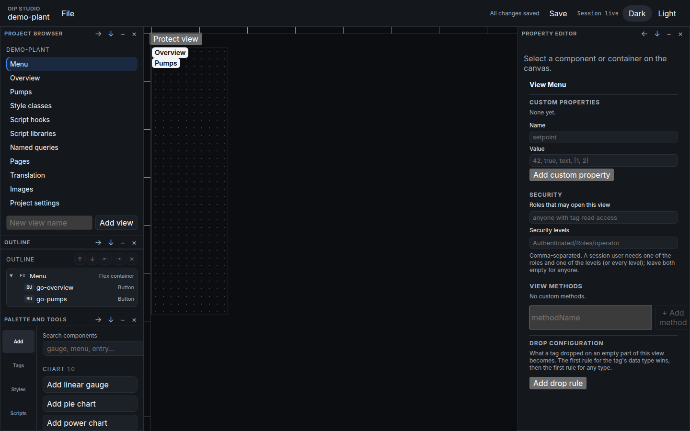
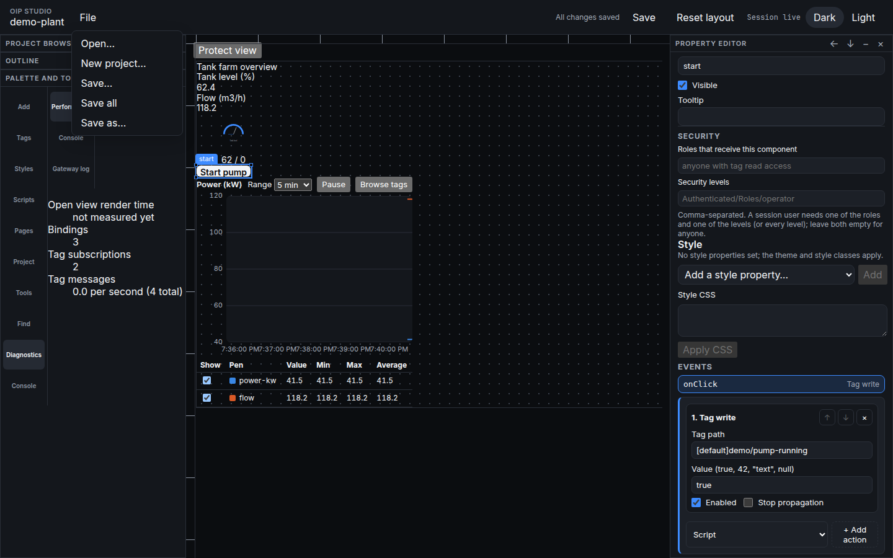
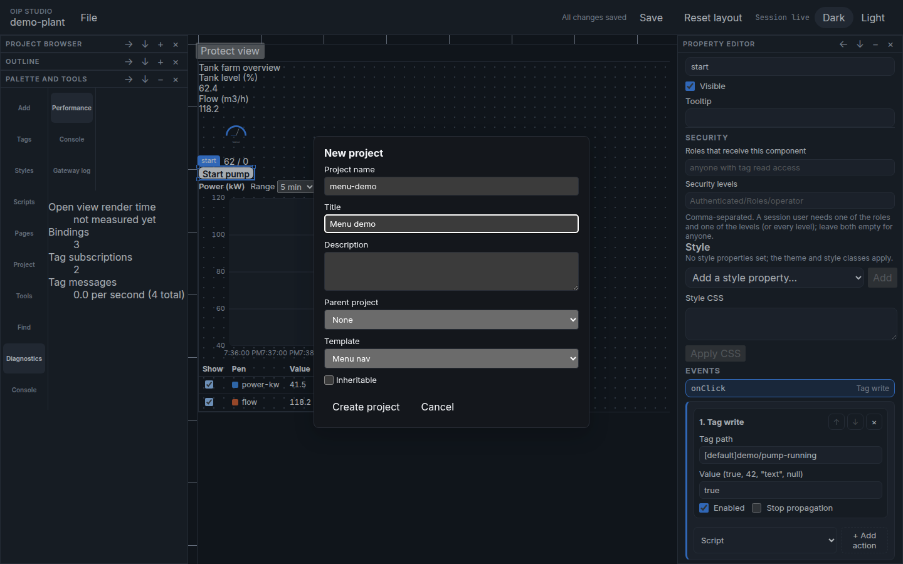
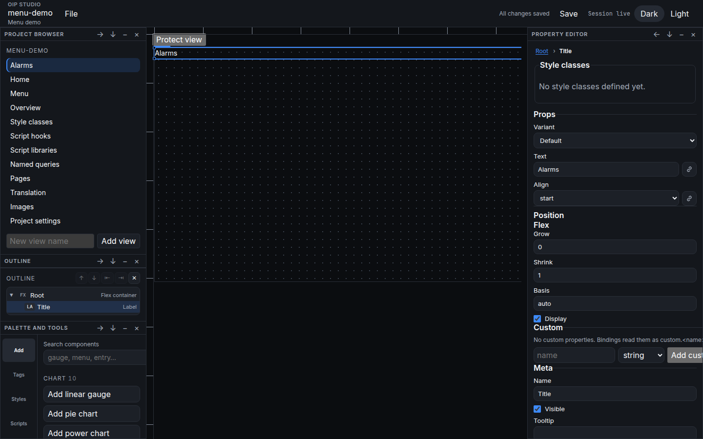

# Open the Control Canvas

The Control Canvas is a web app served by the gateway. Open it from the Home page (**Edit <project> in Control Canvas**), from the Projects page, or directly:

```
http://127.0.0.1:8090/studio/?project=demo-plant
```

If you are not signed in, the Control Canvas asks for your gateway username and password. The project in `?project=` opens; without it the project named `default` opens.



The top bar shows the project name and save state, the **File** menu, **Save**, **Session live** (the canvas is connected to the gateway's live tags) and the theme buttons Daylight, Nightwatch and Process.

## New and other projects

**File** has Open, New project, Save as and Save. **New project…** asks for a **Project name**, **Title**, **Description**, a **Parent project** and an **Inheritable** box, then **Create project**. Pick a **Template**: **Blank** (empty; add views yourself, see [Views and components](views.md)), **Web nav** (a header of page links across the top) or **Menu nav** (a menu docked on the left). The navigation templates create Home, Overview and Alarms views, the pages for them and the shared menu or header, so the project runs at `/hmi/<project>/` straight away.







After **Create project**, the Control Canvas opens the new project in place.
