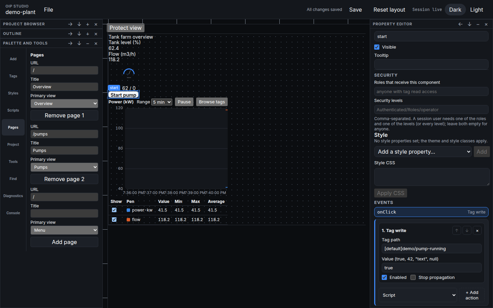

# Pages and navigation

A page gives a view a URL in the runtime. Pages are listed on the **Pages** tab.



## Add a page

1. Open **Pages** and choose **Add page**.
2. Enter the **URL** (for example `/pumps`), a **Title**, and the **Primary view** to show.

**Remove page N** deletes an entry. Without a page configuration, each view is served at `/<view>` and a home view at `/`.

## Navigation menu

A navigation menu is a view docked to a page edge. The page configuration's shared docks hold it: each dock has an id, an edge (left, for example), the view to show and a size. Build a "Menu" view with buttons whose `onClick` is a **Navigation** action to a page URL (`/` or `/pumps`), then declare the dock in the `PageConfig` resource:

```json
{ "pages": [ { "url": "/", "title": "Overview", "primaryView": "overview" },
             { "url": "/pumps", "title": "Pumps", "primaryView": "pumps" } ],
  "sharedDocks": [ { "id": "menu", "edge": "left", "view": "menu", "size": 160 } ] }
```

The Pages tab edits the page list; shared docks are set in the resource through the Config page or API. The **Menu nav** and **Web nav** templates ([Open the Control Canvas](open.md)) write this configuration for you: Home, Overview and Alarms pages plus a left menu dock or a top header. The navigation components in the palette (horizontal menu, menu tree, tree, navigation drawer) are alternatives to a button menu.

## New projects

**File > New project…** offers the templates Blank, Web nav and Menu nav ([Open the Control Canvas](open.md)).
