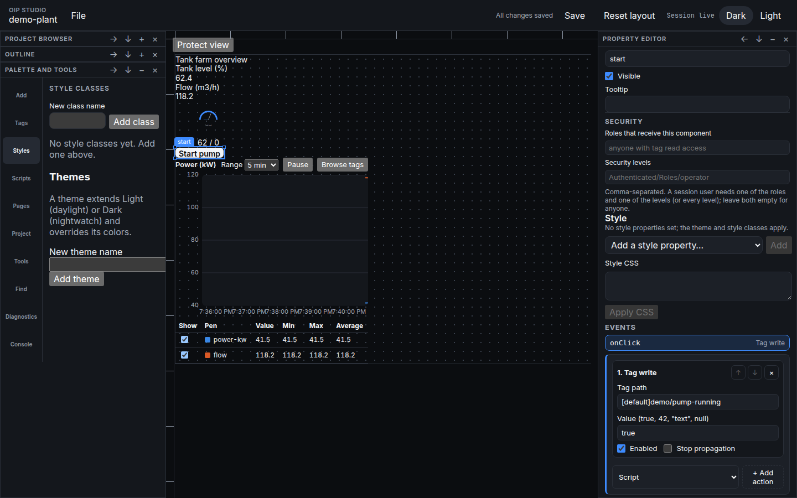

# Styles and style classes

## Themes

The top bar has three themes, Daylight, Nightwatch and Process, plus any theme the project defines. Selecting one previews it on the canvas. The Styles tab also has a **Themes** section: **Add theme** with a new theme name, a base theme and its values.

## Style classes

A style class is a named bundle of style properties you apply to many components.

1. Open the **Styles** tab (or **Style classes** in the Project browser).
2. Type a name under **New class name** and choose **Add class**. Select the class in the list and set properties such as Color or Font size. **Delete <name>** removes a class. Values may use theme variables such as `var(--oip-color-alarm)`.
3. Select a component. At the top of the Property editor, tick the class under **Style classes**.

Editing the class changes every component that uses it.

## Styles on one component

In the Property editor, **Style** has **Add a style property...** and a **Style CSS** box (apply with **Apply CSS**). Use these for one-off changes.
