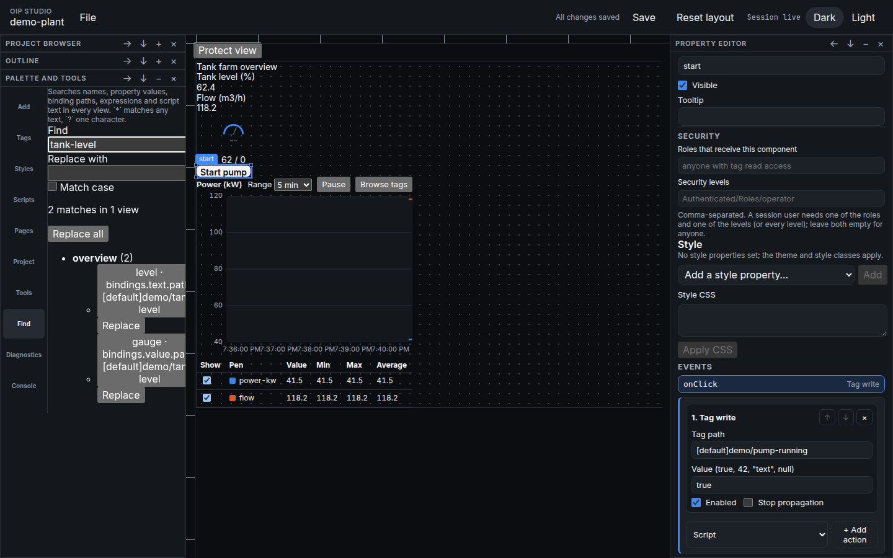
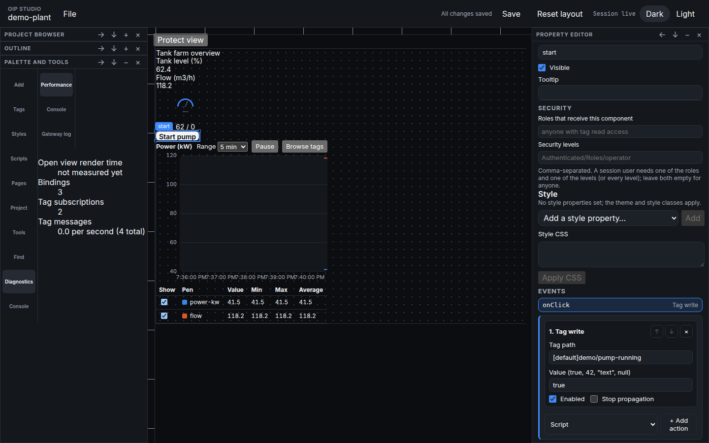

# Find, diagnostics, save and preview

## Find and replace

Open the **Find** tab. It searches names, property values, binding paths, expressions and script text in every view. `*` matches any text and `?` one character. Type in **Find**, optionally **Replace with**, tick **Match case**, and read the match count. Matches are listed; click one to open that view and select the node. **Replace all** applies to every match, and **Undo last replace** reverts it.

## Diagnostics

The **Diagnostics** tab has Performance, Console and Gateway log sections. Performance shows the open view's render time, binding count and tag subscriptions and messages. Gateway log lists recent gateway log records. The **Console** tab runs Python on the gateway as you.

## Save

The top bar shows the state ("All changes saved", or unsaved changes). **Save** writes the open project to the gateway. **File > Save as…** copies the project under a new name. If a save conflicts with a change from elsewhere, the status line says so.

## Preview

The canvas is live, but event scripts do not run on it. To preview, open the project's session in another tab: `/hmi/<project>/`. A save reaches open sessions without reloading ([Sessions](../runtime/sessions.md)).
