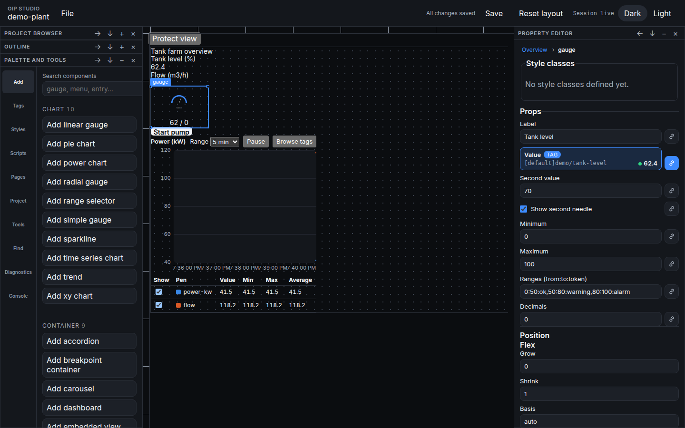
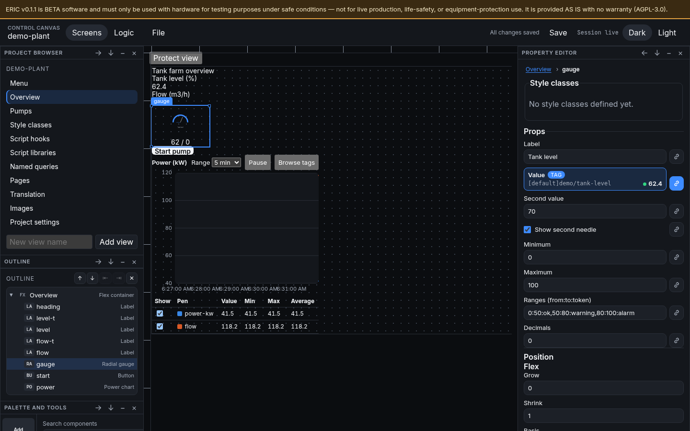

# Views and components

A view is one screen layout, saved as a resource of the project.

## Create a view

1. In the Project browser, type a name in **New view name**.
2. Choose **Add view**. The new view opens on the canvas.

Double-click an existing view in the Project browser to open it.

## Add components

1. Open the **Add** tab. Use **Search components** or scroll the groups (Chart, Container, and others).
2. Choose **Add <component>**, or drag the entry onto the canvas to drop it where you want it.
3. The component is selected; set its props in the Property editor.

The demo Overview view uses labels, a radial gauge, a button, and a power chart.

## Arrange components

- Drag a component on the canvas or resize it by its frame (in a fixed-position container).
- In a flex container, use the **Position** section of the Property editor (grow, shrink, basis and so on).
- Use the Outline to reorder, indent into a container, outdent, or delete.

Changes show on the canvas at once and are saved with **Save** ([Find, diagnostics, save and preview](tools.md)).

Every palette type and its main props are listed in the [component catalog](components.md).
