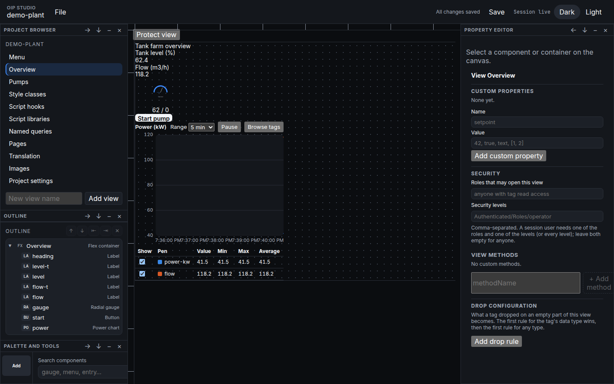
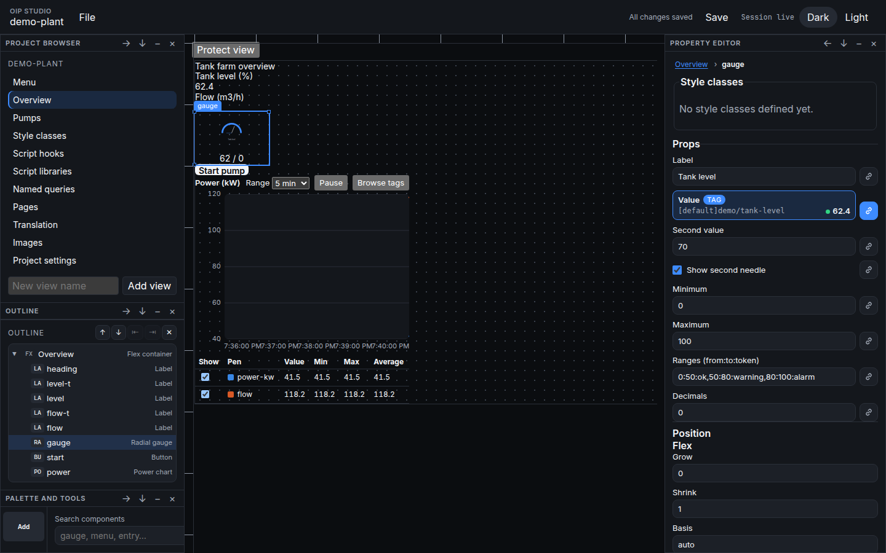
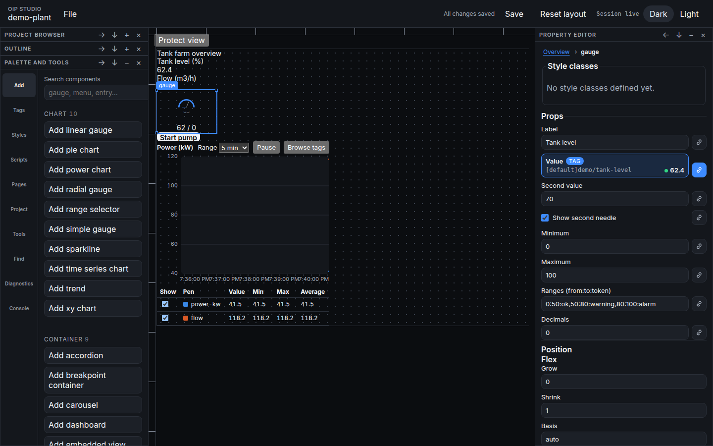
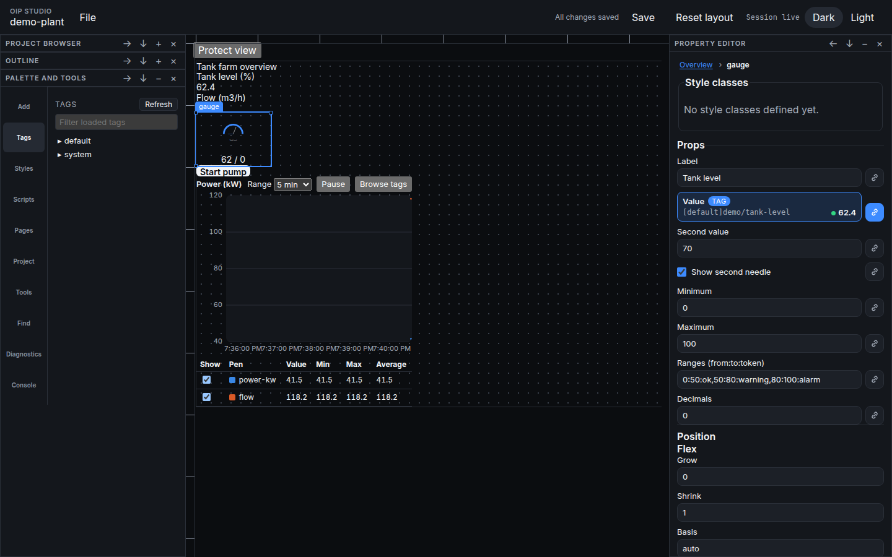

# The workspace

The default layout has four panels around the canvas.

| Panel | Where | What it does |
| --- | --- | --- |
| Property editor | left | Edits the selected component: style classes, props, bindings, position, security, style and events. With nothing selected it edits the view. |
| Canvas | centre | The open view, live. A breadcrumb above the properties shows the selection path. **Protect view** locks the view against other designers. |
| Project browser | top right | The project's views, and the entries Style classes, Script hooks, Script libraries, Named queries, Pages, Translation, Images and Project settings. Also the **New view name** box and **Add view**. |
| Outline | middle right | The view as a tree. Select a node, move it up or down, indent or outdent it, or delete it. |
| Palette and tools | bottom right | Tabs: Add, Tags, Styles, Scripts, Pages, Project, Tools, Find, Diagnostics, Console. |

Each panel header has buttons to dock the panel left, bottom or right, collapse it, or hide it. **Reset layout** in the top bar restores the default.

The right column is shared, so collapse the Project browser and Outline to give the tools tabs more room.

## The tools tabs

- **Add**: the component palette (search, then **Add <component>**), the pipe tool ([Pipes](pipes.md)) and SVG import.
- **Tags**: the tag browser. Drag a tag onto the canvas or onto a component to bind it ([Bindings](bindings.md)).
- **Styles**: style classes and themes ([Styles](styles.md)).
- **Scripts**: project script hooks ([Events and scripts](events-scripts.md)).
- **Pages**: the page list ([Pages and navigation](pages.md)).
- **Project** and **Tools**: project settings; the Tools tab has the query browser, history query, named queries, script libraries and images.
- **Find**, **Diagnostics**, **Console**: see [Find, diagnostics, save and preview](tools.md).

